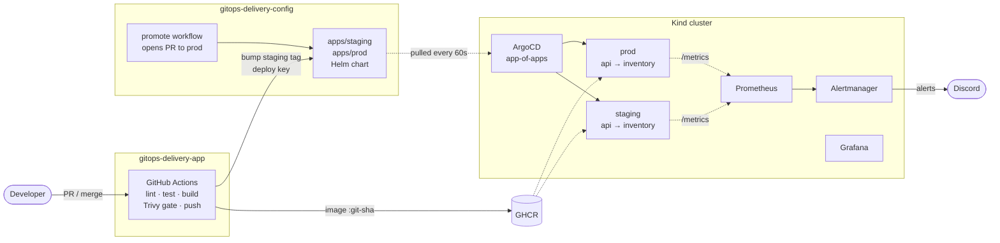

# GitOps Delivery Platform on Kubernetes

[](https://github.com/VirenSawant07/gitops-delivery-app/actions/workflows/ci.yaml)

A pull-based delivery platform for two Python microservices on Kubernetes.
A developer only pushes code. From there, every change is tested, scanned, built, recorded in Git, deployed by ArgoCD, and watched by Prometheus, with alerts sent to Discord.

This repo holds the **application code, CI and docs**.
The cluster's desired state lives in **[gitops-delivery-config](https://github.com/VirenSawant07/gitops-delivery-config)**.

## How it works



| Flow | What happens |
|---|---|
| **Deploy** | Merge to `main` → CI pushes `ghcr.io/virensawant07/gitops-<svc>:<sha>` and commits the new tag to `apps/staging/` → ArgoCD syncs staging |
| **Promote** | Run the `promote` workflow in the config repo → a PR copies staging tags to `apps/prod/` → merging it deploys prod |
| **Rollback** | `git revert` the deploy commit in the config repo → ArgoCD syncs the previous version |
| **Self-heal** | Manual changes to the cluster (`kubectl scale`, `edit`) are reverted to what Git says |
| **Alert** | Error rate, availability, restarts, CPU and memory rules → Alertmanager → Discord, each linked to a runbook |

## The services

| Service | Endpoint | Purpose |
|---|---|---|
| `inventory` | `GET /items` | Stock levels (in memory) |
| `api` | `GET /products` | Calls `inventory` over cluster DNS and returns products with `in_stock`. Returns `502` if inventory is unavailable. |

Both expose `/healthz` (liveness), `/readyz` (readiness), `/metrics` (Prometheus) and the running `version` (the git SHA).
For drills and demos they support fault injection via environment variables: `FAULT_ERROR_RATE`, `FAULT_LATENCY_MS`, and `ALLOW_CRASH` (which enables `POST /crash`).

## Tech stack

| Area | Tools |
|---|---|
| App | Python 3.14, FastAPI, pytest, ruff |
| Containers | Docker multi-stage build, non-root (UID 10001), no pip at runtime |
| CI | GitHub Actions (SHA-pinned), Trivy (digest-pinned), GHCR, Dependabot |
| Kubernetes | Kind (1 control plane + 2 workers), one reusable Helm chart |
| CD | ArgoCD: app-of-apps, git-files ApplicationSet, automated sync + prune + self-heal |
| Secrets | Sealed Secrets (encrypted secrets committed to Git) |
| Observability | kube-prometheus-stack: Prometheus, Alertmanager, Grafana dashboards as code |

## Security

- **Supply chain:** Actions are pinned to commit SHAs and Trivy to an image digest, after the March 2026 attack that re-pointed Trivy's mutable tags. kubeconform downloads are checksum-verified.
- **Blocking scan:** the build fails on fixable CRITICAL CVEs, and PR builds never push or deploy.
- **Minimal images:** removing pip from the runtime image took Trivy's HIGH/CRITICAL findings from **4 to 0**.
- **Pods:** non-root, read-only root filesystem, all capabilities dropped, no privilege escalation, seccomp `RuntimeDefault`, no service-account token.
- **Network:** a NetworkPolicy lets only `api` (and Prometheus) reach `inventory`. An unrelated pod was verified to be blocked.
- **Least privilege:** CI writes to the config repo with a deploy key scoped to that single repo, and never gets cluster credentials.

## Measured results

All numbers were measured on the running system (Kind on a laptop: Ryzen 5 5600H, 16 GB RAM).

| Measure | Result |
|---|---|
| Image size, naive `python:3.14` vs multi-stage slim without pip | 1.67 GB → ~205 MB (−88%) |
| Trivy HIGH/CRITICAL fixable findings, before → after removing pip | 4 → 0 |
| CI run (lint, test, scan, build, push, deploy commit) | ~66 s |
| Merge to `main` → new version running in staging | ~3 min |
| Promote PR merged → prod fully rolled out (6 pods) | ~65 s |
| Manual drift (`kubectl scale`) reverted by ArgoCD | 2 s |
| Worker node drained → pods rescheduled, PDB respected | ~9 s |
| `bootstrap.sh`: ArgoCD installed and root app applied | 1 min 32 s |

## Run it yourself

Requirements: Docker, kind, kubectl, helm, and bash (Git Bash on Windows).

```bash
git clone https://github.com/VirenSawant07/gitops-delivery-config.git
cd gitops-delivery-config
bash bootstrap/bootstrap.sh          # Kind cluster → ArgoCD → everything else from Git
```

Then:

```bash
kubectl -n staging port-forward svc/api 18080:80          # http://localhost:18080/products
kubectl -n argocd port-forward svc/argocd-server 8443:443  # ArgoCD UI
kubectl -n monitoring port-forward svc/monitoring-grafana 13000:80   # Grafana
```

> The SealedSecrets in the config repo are encrypted for the original cluster's key. On a new cluster, re-seal your own Discord webhook and Grafana password with `kubeseal`. See [ADR 5](docs/adr/0005-sealed-secrets-for-secrets-in-git.md).

Local development:

```bash
pip install -r requirements-dev.txt -r services/api/requirements.txt
cd services/api && python -m pytest
```

## Repository layout

```
services/
  api/          FastAPI app, Dockerfile, tests (inventory is mocked)
  inventory/    FastAPI app, Dockerfile, tests
.github/
  workflows/ci.yaml     lint → test → build → Trivy gate → push → bump staging
  dependabot.yml
docs/
  adr/          design decisions
  runbooks/     one per alert
```

## Design decisions

1. [Separate app and config repositories](docs/adr/0001-separate-app-and-config-repositories.md)
2. [Pull-based delivery with ArgoCD](docs/adr/0002-pull-based-delivery-with-argocd.md)
3. [One reusable Helm chart](docs/adr/0003-one-reusable-helm-chart.md)
4. [Immutable image tags and a pinned supply chain](docs/adr/0004-immutable-image-tags-and-pinned-supply-chain.md)
5. [Sealed Secrets for secrets in Git](docs/adr/0005-sealed-secrets-for-secrets-in-git.md)

## Roadmap

- Canary releases with Argo Rollouts and automatic rollback driven by Prometheus analysis
- Kyverno admission policies and cosign-signed images
- SLOs with error-budget burn-rate alerts
- Horizontal Pod Autoscaling with k6 load tests
